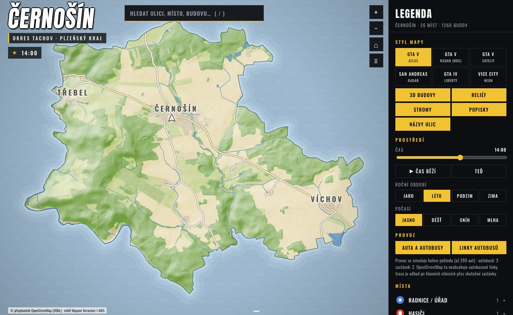

# townyg

GTA-style interactive maps and print-ready posters of any town, generated from open data.

Type a town, get a map in the look of GTA V (atlas, radar, satellite), GTA IV, Vice City or San Andreas: real streets and buildings, shop names as signs on buildings, traffic with buses that stop at real bus stops, day/night, seasons, weather, GPS routing and search.



## Install

macOS with [Homebrew](https://brew.sh):

```sh
brew tap metjum/townyg
brew install townyg
```

Or from a checkout (Python 3.10+, Node for posters):

```sh
python3 -m venv .venv && .venv/bin/pip install -e .
./townyg.sh
```

## Use

```sh
townyg                          # full-screen wizard (arrows, space, Enter)
townyg "Plzeň" -y               # whole town, every style, no questions
townyg "Tachov" --area square --radius 2 --styles gta5,vc --open
townyg --help
```

Output goes to `~/Townyg/mapy/<town>/` (override with `TOWNYG_HOME`):

- `index.html` – the interactive map, open it in a browser
- `plakaty/<style>.png` – 4096 px posters
- `osm.json`, `tiles/` – download cache, an interrupted run resumes

`~/Townyg/mapy/index.html` is a gallery of all generated towns. To remove a town, delete its folder.

The first poster render installs headless Chromium into `~/Townyg/.runtime` (about 150 MB, needs Node).

## How it works

1. Nominatim finds the town and its administrative boundary.
2. Streets, buildings, land cover, water and places are downloaded from OpenStreetMap through Overpass, in 2 km tiles, in parallel, across several mirrors.
3. Terrain from AWS Terrarium tiles becomes a hillshade.
4. A canvas renderer (`townyg/template/app.js`) draws the map; headless Chromium prints the posters.

Large towns can take a few minutes because the public Overpass servers are slow and sometimes overloaded. Finished tiles are cached.

## Develop

```sh
.venv/bin/python -m townyg "Černošín"           # run from the checkout
GPU=1 node dev/perf.mjs <slug>                   # frame-time benchmark (needs playwright)
node dev/shot.mjs <slug> out.png '{"theme":"vc"}'  # screenshot
```

The website lives in `web/` (static, GitHub Pages). The Homebrew formula is in `packaging/homebrew-townyg/`.

## Data and licence

Code: MIT. Map data © [OpenStreetMap contributors](https://www.openstreetmap.org/copyright) (ODbL), relief from Mapzen Terrarium on AWS. Keep the attribution that the map and posters carry. Not affiliated with Rockstar Games; GTA is a trademark of Take-Two Interactive.
