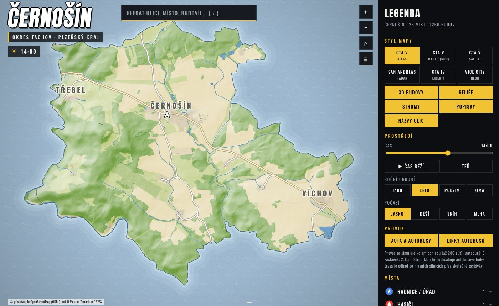
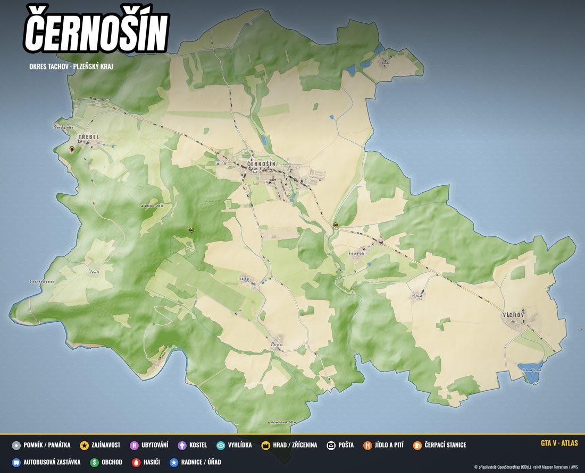
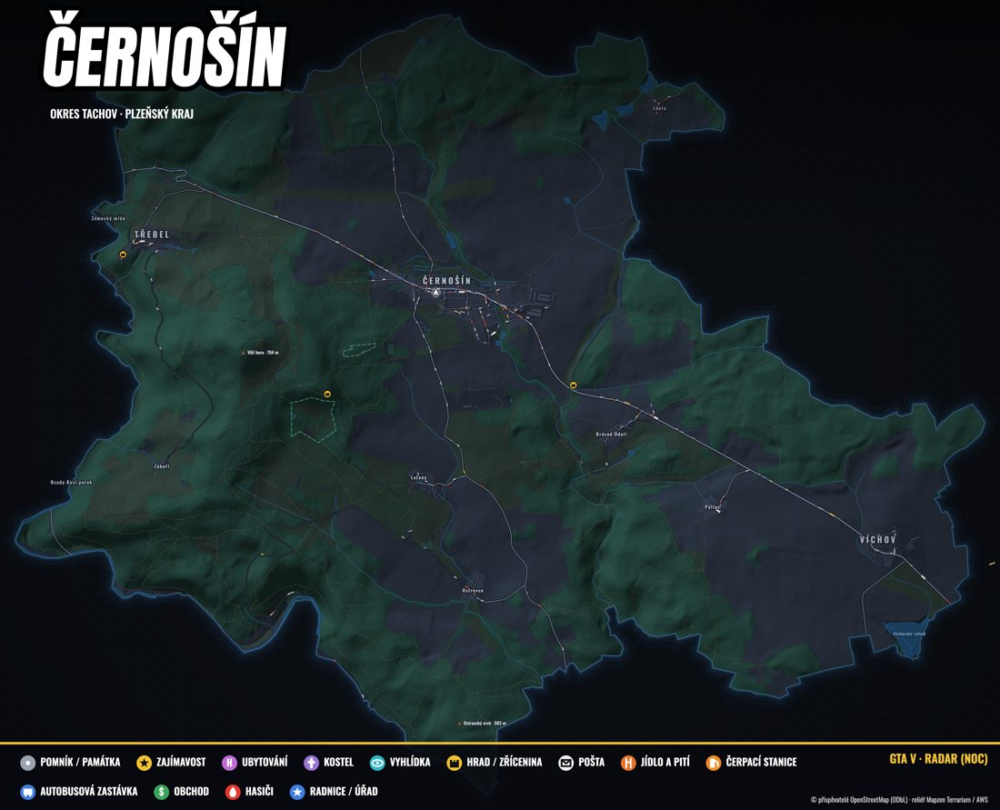
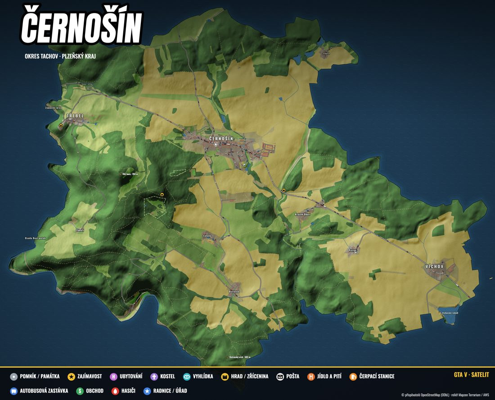
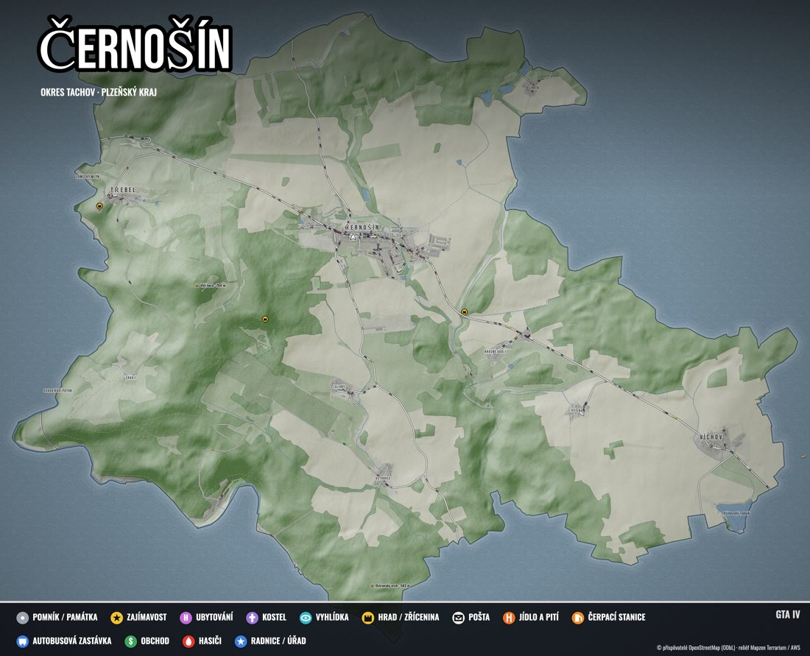
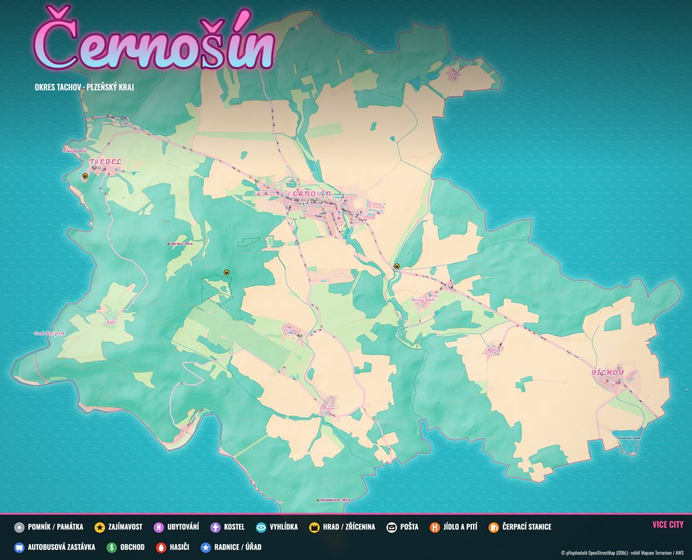
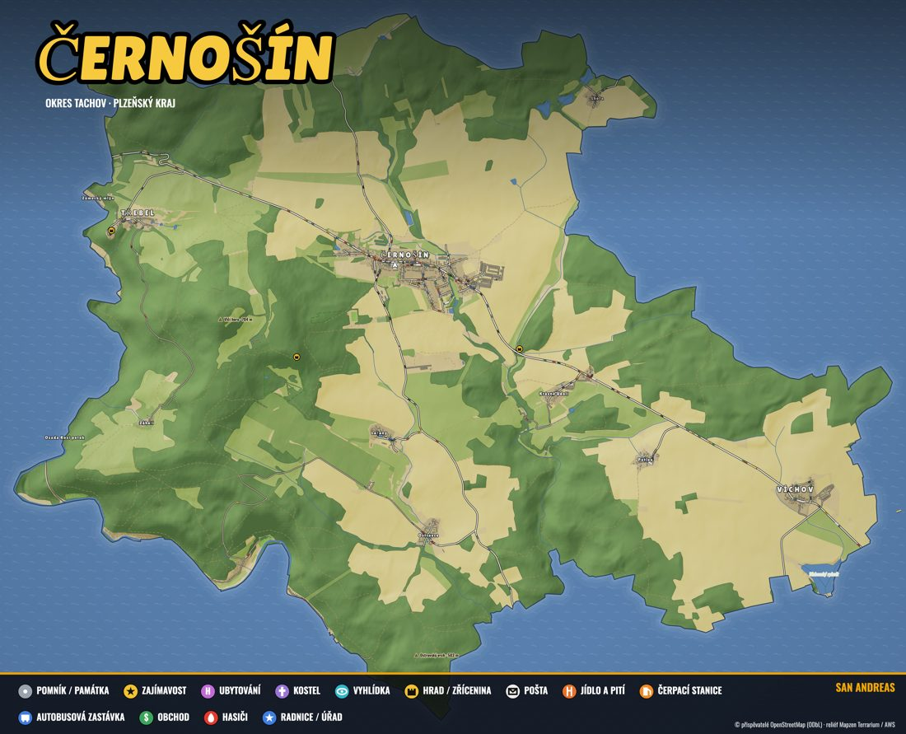

<h1 align="center">townyg</h1>
<p align="center"><b>Your town. Rockstar style.</b><br>
GTA-style interactive maps and print-ready posters of any town, built from open data.</p>

<p align="center">
  <a href="https://github.com/metjum/townyg/releases"></a>
  
  
  
</p>

<p align="center"><a href="https://metjum.github.io/townyg/"><b>Website</b></a> · <a href="#install">Install</a> · <a href="#usage">Usage</a> · <a href="#how-it-works">How it works</a></p>

<p align="center"></p>

Type a town and get a map in the look of **GTA V** (atlas, radar, satellite), **GTA IV**, **Vice City** or **San Andreas**: real streets and buildings, shop names as signs on the buildings, traffic with buses that stop at real bus stops, day and night, seasons, weather, GPS routing and search. The whole municipality is mapped, not just a square around the centre, and everything outside the border is sea.

## Install

```sh
brew tap metjum/townyg
brew install townyg
```

Update later with `townyg update` (or `brew upgrade townyg`). townyg tells you on start when a new version is out.

From a checkout instead (Python 3.10+, Node for posters):

```sh
git clone https://github.com/metjum/townyg && cd townyg
python3 -m venv .venv && .venv/bin/pip install -e .
./townyg.sh
```

## Usage

```sh
townyg                                   # full-screen wizard: arrows, space, Enter
townyg "Plzeň" -y                        # whole town, every style, no questions
townyg "Tachov" --area square --radius 2 --styles gta5,vc --open
townyg update                            # upgrade to the latest release
townyg --help
```

| Option | Meaning |
|---|---|
| `--area city\|square` | whole municipality by its boundary (default) or a square around the centre |
| `--radius km` | half the side of the square (default 2.5), implies `square` |
| `--max-size km` | cap on the longer side of the area (default 18) |
| `--styles` | `all` or a list of `gta5,radar,sat,sa,gta4,vc` |
| `--no-posters` | skip the 4096 px poster render |
| `-y` | no questions, defaults |
| `--open` | open the map in the browser when done |

Everything is written to `~/Townyg/mapy/<town>/` (override with `TOWNYG_HOME`):

```
~/Townyg/mapy/cernosin/
├── index.html        interactive map, open in any browser
├── plakaty/          one 4096 px poster per style
├── osm.json, tiles/  download cache, interrupted runs resume
└── info.json
~/Townyg/mapy/index.html   gallery of all towns
```

To remove a town, delete its folder. The first poster render installs headless Chromium into `~/Townyg/.runtime` once (about 150 MB, needs Node, which brew installs).

## Looks

<table>
<tr>
<td><br><sub><b>GTA V</b> · Atlas</sub></td>
<td><br><sub><b>GTA V</b> · Radar</sub></td>
<td><br><sub><b>GTA V</b> · Satellite</sub></td>
</tr>
<tr>
<td><br><sub><b>GTA IV</b> · Liberty</sub></td>
<td><br><sub><b>Vice City</b> · Neon</sub></td>
<td><br><sub><b>San Andreas</b> · Radar</sub></td>
</tr>
</table>

## How it works

1. **Find**: Nominatim locates the town and its administrative boundary.
2. **Download**: streets, buildings, land cover, water and places come from OpenStreetMap through Overpass, in 2 km tiles, in parallel, across several mirrors with retries. Finished tiles are cached.
3. **Shade**: terrain from AWS Terrarium tiles becomes a hillshade relief.
4. **Render**: a canvas renderer (`townyg/template/app.js`) draws the map with cached layers, spatial indexes and lazy trees so it stays smooth even for a whole city. Headless Chromium prints the posters.

Public Overpass servers are sometimes slow or overloaded, so a big city can take a few minutes. Shop names are only those present in OpenStreetMap, so small villages have few. Fix that on [openstreetmap.org](https://www.openstreetmap.org) and everyone benefits.

## Develop

```sh
.venv/bin/python -m townyg "Černošín"                    # run from the checkout
GPU=1 node dev/perf.mjs <slug>                            # frame-time benchmark (needs playwright)
node dev/shot.mjs <slug> out.png '{"theme":"vc"}'         # screenshot
packaging/release.sh 0.2.0                                # tag, release, update the Homebrew tap
```

The website is the static page in `docs/` (GitHub Pages). The Homebrew formula lives in `packaging/homebrew-townyg/` and is mirrored in the [tap repo](https://github.com/metjum/homebrew-townyg).

## Data and licence

Code is MIT. Map data © [OpenStreetMap contributors](https://www.openstreetmap.org/copyright) (ODbL), relief from Mapzen Terrarium on AWS. Keep the attribution the maps and posters carry. Not affiliated with Rockstar Games; GTA is a trademark of Take-Two Interactive.
